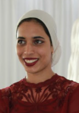

::: hero
::: hero-photo
{.portrait fig-alt="Portrait of Raeesa Manjoo-Docrat"}
:::

::: hero-text
::: eyebrow
Statistics · Spatial epidemiology
:::

# Dr Raeesa [Manjoo-Docrat]{.nowrap} {.unnumbered .unlisted}

::: role
Senior Lecturer, School of Statistics and Actuarial Science, University of the Witwatersrand, Johannesburg
:::

::: links
[Email](mailto:manjoo.raeesa@gmail.com)
[Google Scholar](https://scholar.google.com/citations?user=nqGypBUAAAAJ&hl=en)
[ORCID](https://orcid.org/0000-0003-2039-0440)
[ResearchGate](https://www.researchgate.net/profile/Raeesa-Docrat)
[LinkedIn](https://www.linkedin.com/in/raeesa-docrat-88228bb1/)
:::
:::
:::

::: lede
I develop statistical methods for understanding how infectious diseases spread through space and time, and use them to inform public health decisions in South Africa and beyond.
:::

I am a Senior Lecturer in Statistics at the [University of the Witwatersrand](https://www.wits.ac.za), where I have taught since 2018. My work centres on spatio-stochastic models that capture the spatially uneven way epidemics spread, with applications to COVID-19, tuberculosis and wastewater-based disease surveillance. I completed a postdoctoral fellowship in tuberculosis modelling at [Johns Hopkins University](https://www.jhu.edu) in 2024.

I am a founding member of [**SEPIMOD**](https://raymandoc.quarto.pub/sepimod/), the Spatial Epidemiological Modelling Group, which brings together Wits, the University of Pretoria, the CSIR, the South African Medical Research Council and IBM. I am also a founding member of the **Old Mutual–Wits Risk Lab**. I care a great deal about creating inclusive STEM opportunities for South Africans, particularly women, and coordinate mentoring for [STEM MentHer](https://www.stemmenther.co.za/).

::: stats
::: {}
[10]{.num}
[peer-reviewed papers]{.lbl}
:::
::: {}
[70]{.num}
[citations]{.lbl}
:::
::: {}
[R800k]{.num}
[active funding as PI]{.lbl}
:::
::: {}
[16]{.num}
[students supervised]{.lbl}
:::
:::

## Research

::: themes
::: theme
::: {}
### Spatio-stochastic models of disease spread
Discrete-time binomial chain models with spatial structure, capturing local transmission, interaction between regions and movement between spatial units.
:::
:::

::: theme
::: {}
### Spatial epidemiology of COVID-19
Spatially explicit, age-stratified SEIR models that combine mobility data with a vulnerability index reflecting socioeconomic and health disparities, to guide targeted public health responses.
:::
:::

::: theme
::: {}
### Wastewater-based surveillance
Low-cost, community-level surveillance from wastewater, including methods for spatially misaligned data, early warning and hotspot detection in urban and peri-urban settings.
:::
:::

::: theme
::: {}
### Tuberculosis in vulnerable populations
Individual-based models of TB in high-risk groups, the effect of COVID-19 disruptions on TB epidemiology, and spatial optimisation of vaccination and resource allocation.
:::
:::

::: theme
::: {}
### Non-communicable diseases
Spatio-temporal analysis of non-communicable diseases, a new programme funded by IMSA and Investec (2026–2029).
:::
:::

::: theme
::: {}
### Teaching statistics with R
Evaluating how R is taught across undergraduate and postgraduate curricula, and building open-source tools for spatial epidemiological modelling.
:::
:::
:::

## Education and positions

::: entries
::: entry
[2025 – now]{.when}

::: what
**Senior Lecturer, Statistics and Actuarial Science**

[University of the Witwatersrand · since November 2025]{.meta}
:::
:::

::: entry
[2018 – 2025]{.when}

::: what
**Lecturer, Statistics and Actuarial Science**

[University of the Witwatersrand]{.meta}
:::
:::

::: entry
[2024]{.when}

::: what
**Postdoctoral Fellow, tuberculosis modelling**

[Johns Hopkins University, USA]{.meta}
:::
:::

::: entry
[2022]{.when}

::: what
**PhD in Statistics**

[University of the Witwatersrand · *The spatio-stochastic modelling of the spread of infectious diseases* · Supervisor: Prof. Frank Beichelt]{.meta}
:::
:::

::: entry
[2018]{.when}

::: what
**MSc in Statistics, with distinction**

[University of the Witwatersrand · *Generating functions in branching and birth-and-death processes* · Supervisor: Prof. Frank Beichelt]{.meta}
:::
:::

::: entry
[2015]{.when}

::: what
**BSc Honours, Mathematics and Mathematical Statistics**

[University of the Witwatersrand · Liberty Life Gold Medal, top student in Mathematical Statistics]{.meta}
:::
:::

::: entry
[2013]{.when}

::: what
**Postgraduate Diploma in Statistics and Actuarial Science**

[University of the Witwatersrand]{.meta}
:::
:::

::: entry
[2012]{.when}

::: what
**BSc in Mathematics**

[University of the Witwatersrand]{.meta}
:::
:::
:::

## Leadership and service

::: entries
::: entry
[Founding member]{.when}

::: what
[SEPIMOD](https://raymandoc.quarto.pub/sepimod/), the Spatial Epidemiological Modelling Group (Wits, University of Pretoria, CSIR, SAMRC, IBM); Old Mutual–Wits Risk Lab
:::
:::

::: entry
[Mentoring]{.when}

::: what
Mentor Coordinator, [STEM MentHer](https://www.stemmenther.co.za/) (2025 – now). Co-author of the *Indigenising Mentorship* framework for African early-career academics (2025).
:::
:::

::: entry
[Service]{.when}

::: what
SASA 2026 Local Organising Committee and Scientific Programme Committee; organiser, [ASA DataFest](https://scholar.google.com/citations?view_op=view_citation&hl=en&user=nqGypBUAAAAJ&citation_for_view=nqGypBUAAAAJ:Y0pCki6q_DkC) (2025 and 2026); reviewer for *Spatial Statistics*.
:::
:::
:::

## Awards

::: entries
::: entry
[2025]{.when}

::: what
**Wits Early Career Academic Development (ECAD) Programme**
:::
:::

::: entry
[2023]{.when}

::: what
**Silver Medal, best poster**

[Spatial Statistics Conference, Boulder, USA]{.meta}
:::
:::

::: entry
[2021]{.when}

::: what
**Mathematical Sciences Early Career Fellowship**
:::
:::

::: entry
[2015]{.when}

::: what
**Liberty Life Gold Medal**

[Top student, Mathematical Statistics Honours]{.meta}
:::
:::

::: entry
[2011]{.when}

::: what
**Certificate of First Class**

[Discrete Mathematics (MATH2020)]{.meta}
:::
:::

::: entry
[2010]{.when}

::: what
**University Entrance Scholarship**
:::
:::
:::
